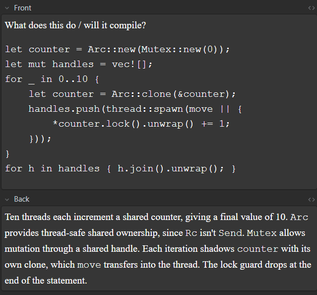

# Why AI?

My feelings about AI use are a bit complicated:

- What about environmental concerns?
- What about artists and musicians?
- Is it going to take every tech job?
- Is it going to take /every/ job?
- Are going to have a Luddite-like event that is so big it's name replaces the term?
- But what I can make with it in less than an hour is pretty cool
- And wow, it is an incredible learning/teaching/research tool

I'm not sure I have a cohesive 'stance' on any of it. While I am very concerned, I'm almost equally as excited.

On the one hand, the problems it presents are social/societal co-ordination problems (environmental impact, proper usage, limits on application) and these are generally considered, by most sane people, a little bit tricky to solve. There's an enormous capacity to damage and degrade lives & livelihoods if used improperly.

On the other, the advantages in 'productivity', whether that's time saved, effort focused, abilities enhanced or knowledge/understanding gained, are really quite massive. If you're like me and have a hundred interests and not enough hours in the day to get into the weeds and process everything you need to get what you want out of a given hobby/interest, it's incredibly enabling.

## I.E. Socratic Tutor mode

I recently set up a project in Claude which puts it into a "socratic tutor" mode. I told it I want to build an SQLite-like database in Rust. I told it I only have some surface familiarity with Rust but that I'm working through the book and some problems, and what reading/research I've already done into databases. We then built the scaffolding and timeline for the project. Claude is currently grilling me through the requirements process, and asking me hard questions I often need to go away and do research to answer. An excerpt from one of our chats:

> **Claude**: Your REPL user types put name rowan, sees OK, and one millisecond later the laptop loses power. They reopen the database. What must be true, what may be true, and what must never be true? And what does your code have to have done before printing OK for your answer to hold?
---
> ***Me**: The log must contain a record of the command. The command may have resolved with a write, it may also be true that it did not. It should never be true that the log does not contain the command. 
> The only steps in the full command-response cycle that may not resolve before an OK is a) the sync to disc and b) the writing of the LSM ID to the page header. 
> This allows the program issuing commands to proceed without waiting for the slowest segment of the operation while providing a guarantee that /providing/ the command completed, the state of the DB is recoverable. The command cannot return OK without satisfying the guarantee.*
---
> **Claude**: A directory it is. Your answer gets a lot right, and it also contains one contradiction worth finding yourself.
>
> What’s right:
>
> Logging before acknowledging is exactly the write-ahead principle. You’ve also rightly separated logged from applied. If the command is in the log, recovery can finish applying it, so it doesn’t matter whether the apply step happened before the crash.
>
> Deferring the page update is standard. On terminology, I think you mean LSN (log sequence number). Writing it into the page header is how real engines track how far each page has caught up. That raises a follow-up for later: during recovery, how would you use that page LSN to stop yourself applying the same command twice?
>
> Where it doesn’t hold up:
>
> Take my scenario literally: the laptop loses power one millisecond after OK. You’ve said the sync to disk may still be outstanding at that point.
>
> Your code called write() on the log file and got success back, but nothing has called fsync yet. Where do those bytes physically exist at that moment? Once >you’ve answered that, is your rule “it should never be true that the log does not contain the command” still true after the power cut?
>
> Fair warning: the answer doesn’t mean your instinct to avoid waiting on the slow part is wrong. It means you have to say precisely which failure your guarantee covers, and that’s a requirement worth writing down.
---

The conversation went on and we got into a few interesting design discussions, it (quite painfully) diagnosed I didn't get tombstones on the first questioning. And unlike a lot of my conversations of AI which go something like "you're so right, let me confirm your biases", in the scope of this project, Claude has been quite the strict teacher and done an excellent job of exposing my (numerous) gaps in understanding.

## I.E. Anki Decks

One thing that always gave me resistance when using Anki many many years ago is how laborious it was to devise and input flashcards from learning material. Claude completely sidelines that friction. You can give it a brief, review the deck and make refinements, and get it in as an actionable place to do learning in 30 minutes. And of course it can adjust the cards based on inputs like your own notes

## I.E. Karpathy LLM Wiki

Badmephisto's (IYKYK) take on LLMs + personal wikis. I've not actually tried this yet, but it's a fascinating use that inverts the usual 'way' where you make notes in folders and give them structure and links etc and have an LLM do the extra bits and bobs of work and answer questions and so on. Instead you hand over control of the wiki structure etc entirely to the LLM - basically all you ever do is pass in notes and maintain an index. These notes are then entirely organised, structured and linked according to the LLM.

https://gist.github.com/karpathy/442a6bf555914893e9891c11519de94f

## I.E. The Future of Tech Employment

In a very practical sense, being comfortable with using LLMs and understanding their capabilities and issues is going to be core in QA & Development work in the near-future. I can get experience in a bounded domain at work (the Playwright project, levelling up manual work) - in my personal stuff I can throw whatever I like at it in the way I like, and get hands-on experience trying out multi-agent workflows, MCP tooling and so on. 

---

It's an interesting position to be in: while it's easy to feel downtrodden and like I might be replaceable, I'm also feeling empowered to become irreplaceable. Not just to quickly make fun little things, but enabled to learn how to make interesting big things, and I'm excited about being able to just 'do stuff', without it taking a week of fighting my own ignorance, inattention and various little language/deployment gotchas, while balancing real life and other interests. It's also given me a second wind when it comes to self-managed learning, something I really burnt out of around COVID and have only been able to stick to for a few weeks at a time when I've got something specific to grind out. Being able to actually maintain a personal wiki with contents produced from Claude aggressively grilling my understanding, along with inputs from my own reading, is kinda invigorating. 