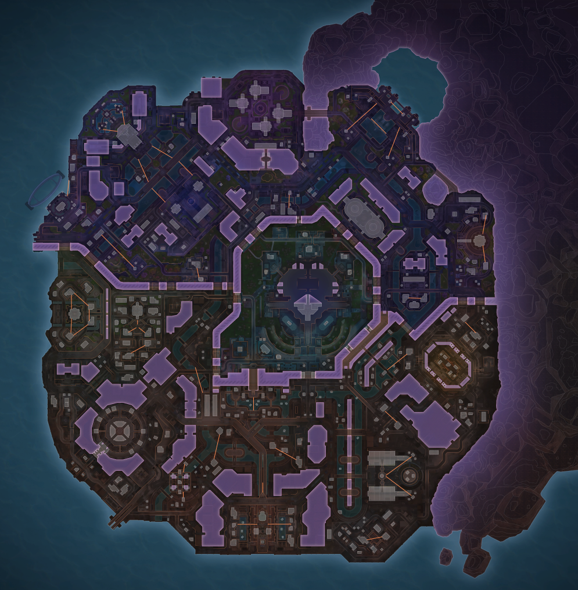

# Apex Points of Interest

Apex Legends is a battle-royale style game where 60 players are sorted into 3-man teams, exert some choice over where they land on the map, then gather equipment to fight other players, competing to become the last team standing. The maps gradually shrink in playable area to create risk and force players to move, and players move through designated areas on the map called 'Points of Interest' (PoIs).

PoIs are connected by various means - sometimes they are adjacent at two ends of a flat area, others are not adjacent, split by mountainous impassable terrain. Some PoIs are made adjacent through otherwise impassable terrain by tunnels or thinner paths. There are a couple of means of getting around faster than walking across plains or through paths - ziprails and cannons, the first allows players to glide along a rail, the latter launches the player a significant distance (but most legends (player avatars with various capabilities) cannot influence their destination PoI). The following shows what the map E-District looks like top-down, with the purple sections representing impassable terrain:



So we have PoIs, and routes to PoIs. We're of course describing a graph of nodes and edges. I've never seen a graph representation of an Apex map, so I thought I'd look into making one.

The first challenge (the one I'm working on) is automating the extraction of PoIs. There doesn't seem to be anywhere on the web that shows a 2d, top-down view of all the PoIs on each map in active rotation. There /are/ up-to-date images hosted on apexlegendsstatus.com, for example: https://apexlegendsstatus.com/interactive-map/mp_rr_desertlands_mu5 - however these don't have PoI labelling - I may just have to do the input by hand into a JSON object, i.e.

```json
{
  "map": {
    "id": "mp_rr_desertlands_mu5",
    "name": "World's Edge",
    "coordinateSystem": "normalised",
    "lastUpdated": "2026-10-11"
  },
  "nodes": [
    {
      "id": "fragment-east",
      "name": "Fragment East",
      "position": { "x": 0.46, "y": 0.38 },
      "tags": ["urban", "hot-drop"]
    },
    {
      "id": "fragment-west",
      "name": "Fragment West",
      "position": { "x": 0.39, "y": 0.37 },
      "tags": ["urban"]
    },
    {
      "id": "skyhook",
      "name": "Skyhook",
      "position": { "x": 0.18, "y": 0.22 },
      "tags": ["industrial"]
    }
  ],
  "edges": [
    {
      "id": "e1",
      "from": "fragment-west",
      "to": "fragment-east",
      "type": "open-ground",
      "directed": false
    },
    {
      "id": "e2",
      "from": "fragment-west",
      "to": "skyhook",
      "type": "tunnel",
      "directed": false,
      "notes": "Narrow path through the ridge"
      // etc etc
    }
  ]
}

```

One alternative is to boot the game, open the map during the drop phase, and confirm if the PoIs are labelled here. If so, I can take a screenshot, and then extract the data from that. Unfortunately the map only rotates once every 4 hours, so I would have to play Apex a few times (woe is me :))


