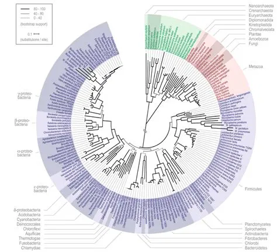
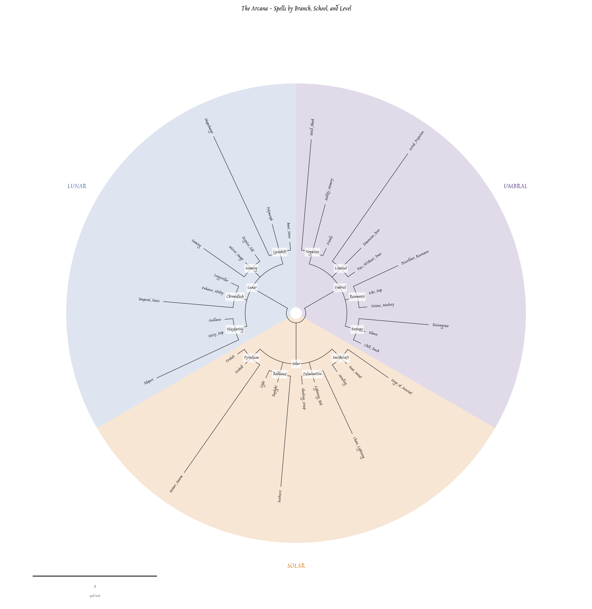
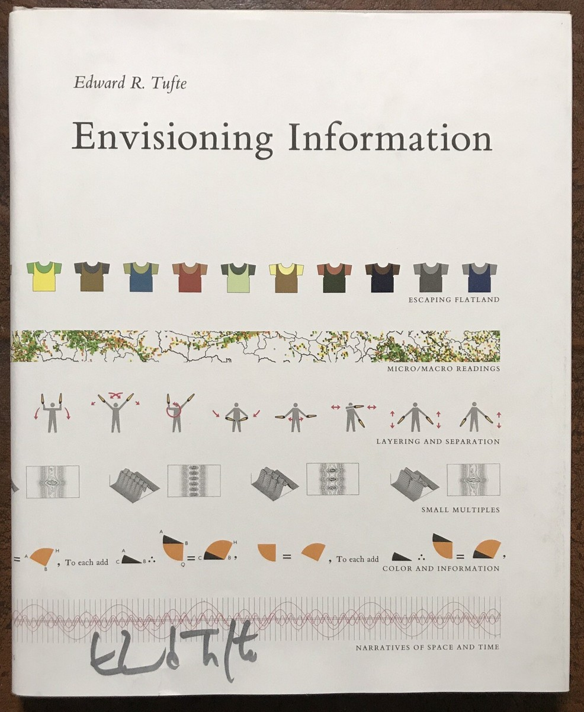

# Grimonomy

> A taxonomy of the things in grimoires

I always thought Newick trees were really, really cool. See below:



Neat, right?

They're not incredibly readable at the detailed level but to show tree-like relationships at a high-level, in a compact format, I think they're great.

While worldbuilding for my DND campaign (which will start one day, maybe) I had a thought that they'd be a fantastic way to show the taxonomy of my magical system, which organises (mostly) existing DND 5e spells by one of (my homebrewed) three primary/primal energy sources.

## The Repo

The repo contains just two files:
```
- build_arcana.py
- circular_tree.py
```

### Build Arcana

This fairly short file takes the input data set and tokenises and interprets it into a Newick string. Presently the data is in the code as a series of `spell()` objects within school lists. The spells are just strings with numbers (name and level). The schools are then organised into the overarching branch (Solar, Lunar, Umbral), and associated with a step level. After building the newick string, the imported `draw_circular_tree()` is called.

### Circular Tree

This file uses numpy and matplotlib to actually generate the graph. After defining the Node object, Newick string parser and various element/property drawing logic (scale, branches, arcs etc), the tree is laid out, the family (clade) laid behind it.

After generating a few test graphs, I decided to play around with the y-axis to represent the spell level:



This isn't bad, but it's nowhere near as cool as the first picture, right? Current working theory is the base coolness of the Newick-tree based cladogram is quite high, but scales with the number of levels within the dataset.

## Next Steps

First next task is to flesh out the script so it takes a json object with various spell properties, then: 
- throw a conversion script together calling from https://open5e.com
- add new sub-schools via a hierarchy of fundamental spells (representing a spell discovery leading to new discoveries). This way we enhance the coolness factor of the cladogram and add depth to the system (as an 'unlock' mechanic for my players).

I want to have a think about the position of the school labelling too, as well as the possibility of further dimensions like subschools. The general appearance needs refining eventually too, I'm thinking a classic parchment flavour and borrowing some tufte-like colours rather than the large clade blocks.



One interesting path to explore later on would be to present this in a website where each node or branch can be clicked to get information about it in a panel to the side. Ideally, we mask/blur the entire tree, and my players could input their unlocked spells (saving to localStorage), so they see the tree be revelead dynamically as they learn fundamental spells, unlock sub-schools, and discover new kinds of magic.

Thanks for reading :)

